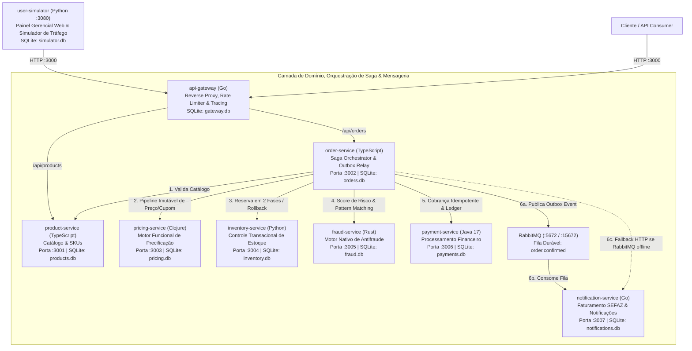
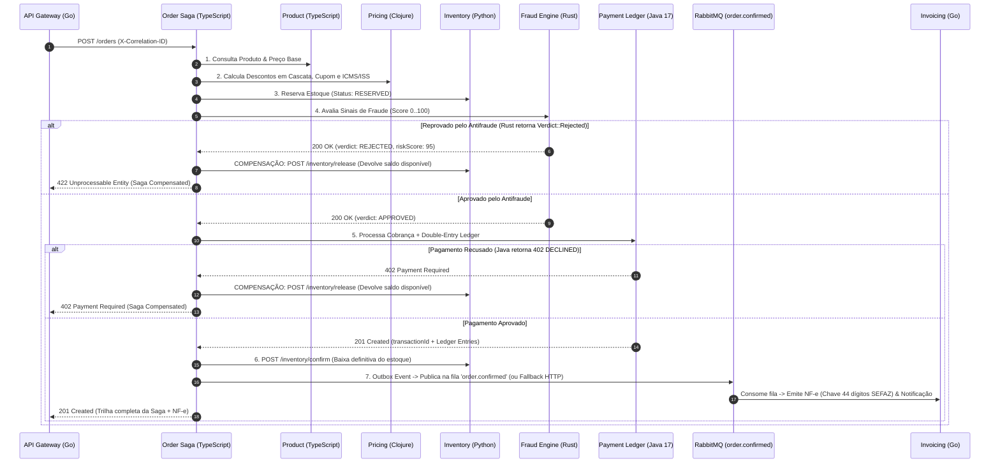

# Polyglot E-Commerce Microservices — Distributed Architecture & Paradigm Sandbox

> **Um laboratório prático de Engenharia de Software para explorar Sistemas Distribuídos, Consistência Eventual (Saga Pattern), Transactional Outbox com RabbitMQ, Persistência Poliglota Isolada e o contraste real entre múltiplas linguagens de programação e paradigmas.**

---

## 1. Visão Geral e Motivação de Engenharia

Na engenharia de software moderna, a maioria dos projetos de estudo limita-se a reproduzir operações CRUD utilizando uma única linguagem e um único banco de dados compartilhado. Embora funcional para aplicações monolíticas simples, esse modelo não expõe os desafios reais de **arquitetura distribuída**: falhas parciais de rede, transações sem *Two-Phase Commit (2PC)*, concorrência sob alta carga, idempotência financeira e adequação de paradigmas de programação ao domínio do problema.

Este projeto nasceu como um **Sandbox Arquitetural Intencionalmente *Over-Engineered*** de um E-Commerce completo. O objetivo não é apenas processar um pedido, mas responder na prática a perguntas fundamentais de engenharia:

1. **Como manter a integridade dos dados quando um único checkout atravessa 7 serviços independentes sem compartilhar banco de dados?**
2. **Como reverter efeitos colaterais (como um estoque já reservado) quando o motor de antifraude ou o gateway de pagamento reprova a compra no meio do caminho?**
3. **Na prática, onde cada paradigma — Funcional Imutável (Clojure), Systems/Memory-Safe sem GC (Rust), Concorrência CSP & Binários Estáticos (Go), Orientação a Objetos Corporativa (Java 17), Event-Loop Assíncrono (TypeScript) e Analítico/Expressivo (Python) — realmente brilha?**

---

## 2. Desenho da Arquitetura

O ecossistema é composto por **8 microsserviços independentes**, um **Message Broker (RabbitMQ)** e um **Simulador de Tráfego & Painel Gerencial Web**, escritos em **6 linguagens distintas** (após a substituição de segurança do PHP por Go no `notification-service`), onde **cada serviço possui seu próprio banco de dados SQLite isolado** (*Database-per-Service Pattern*).



---

## 3. Padrões de Engenharia e Sistemas Distribuídos Aplicados

### 3.1. Database-per-Service com Isolamento Estrito (Bancos SQLite Isolados)
Um dos anti-padrões mais comuns na migração para microsserviços é o *"Monolito Distribuído"*, onde vários serviços continuam fazendo `JOIN` nas mesmas tabelas de um banco centralizado.

Neste projeto, **nenhum serviço de domínio enxerga o banco de dados do outro**:
- Cada microsserviço gerencia exclusivamente seu arquivo `.db` local (`gateway.db`, `products.db`, `orders.db`, `pricing.db`, `inventory.db`, `fraud.db`, `payments.db`, `notifications.db`).
- A escolha do **SQLite (em modo WAL - *Write-Ahead Logging*)** para cada nó permite ter **bancos relacionais reais e transacionais (ACID)** rodando simultaneamente com consumo mínimo de memória, facilitando a inspeção individual de schemas, índices e registros gerados em cada etapa.

### 3.2. Padrão Saga Orquestrado & Transações de Compensação
Em um ambiente distribuído, não é viável abrir uma transação SQL global (`BEGIN ... COMMIT`) que atravesse Node.js, Clojure, Python, Rust, Java e Go simultaneamente. Para resolver isso, o `order-service` implementa o **Saga Execution Coordinator (SEC)**:



### 3.3. Reserva de Estoque em Duas Fases (*Two-Phase Inventory Reservation*)
Para evitar *overselling* (vender o mesmo item para dois clientes concorrentes enquanto o cartão ainda está sendo processado), o `inventory-service` (Python) separa o estoque em duas colunas atômicas: `available_qty` e `reserved_qty`:
1. **`/inventory/reserve`**: Deduz de `available_qty` e incrementa `reserved_qty` com lock transacional (`BEGIN IMMEDIATE`).
2. **`/inventory/confirm`**: Quando o pagamento é aprovado no Java, abate definitivamente de `reserved_qty`.
3. **`/inventory/release` (Compensação)**: Se o Rust detectar fraude ou o Java recusar o cartão, a quantidade reservada volta integralmente para `available_qty`.

### 3.4. Idempotência Financeira e Livro-Razão (*Double-Entry Bookkeeping*)
No `payment-service` (Java 17), cada cobrança recebe uma chave determinística (`idempotency_key`) vinculada ao pedido e ao `X-Correlation-ID`. Além do registro do pagamento, o serviço aplica o princípio contábil de **Partidas Dobradas** na tabela `ledger_entries`: cada centavo cobrado gera simultaneamente um lançamento de **DÉBITO (`DEBIT`)** na conta de recebíveis do cliente e um lançamento de **CRÉDITO (`CREDIT`)** na conta de liquidação da plataforma.

### 3.5. Transactional Outbox Pattern + Fila RabbitMQ (`order.confirmed`) com Fallback HTTP
No Passo 7 da Saga, para evitar perda de eventos de faturamento após a confirmação financeira:
1. O `order-service` grava o evento `OrderConfirmedEvent` na tabela local `outbox_events` (`orders.db`) com `published = 0`.
2. **Com RabbitMQ ativo (Docker)**: O evento é publicado na fila durável **`order.confirmed`** do RabbitMQ e marcado como `published = 1`. O `notification-service` (Go) possui uma goroutine consumidora dedicada que lê a fila `order.confirmed`, emite a NF-e de forma **idempotente** por `order_id` e registra os disparos em `notifications.db`.
3. **Fallback HTTP Automático (Execução local `.ps1` sem Docker)**: Caso o RabbitMQ não esteja rodando localmente, o `order-service` realiza o fallback transparente via `POST /notifications/order-confirmed` diretamente para o serviço em Go e conta com um worker *Outbox Relay* em background a cada 5 segundos para reprocessar eventuais mensagens pendentes (`published = 0`).

---

## 4. A Engenharia por trás de cada Escolha de Linguagem

A seleção das linguagens não foi aleatória. Cada serviço foi projetado para demonstrar como as características intrínsecas de uma linguagem, seu sistema de tipos e seu *runtime* resolvem um problema específico de engenharia:

### 1. Go (`api-gateway` — Porta `3000`)
- **Problema de Domínio**: Roteamento reverso na borda, controle de *Rate Limiting* concorrente por IP, injeção de `X-Correlation-ID` e agregação de *Health Check* de todos os serviços.
- **Por que Go?** Go foi desenhado no Google exatamente para infraestrutura de rede e proxies (como Traefik, Docker e Kubernetes). Suas *goroutines* com *channels* e `sync.WaitGroup` permitem consultar a saúde dos 7 microsserviços downstream **em paralelo** em poucos milissegundos, com um binário estático que consome menos de 15 MB de RAM.

### 2. TypeScript / Node.js (`product-service` `:3001` & `order-service` `:3002`)
- **Problema de Domínio**: Exposição ágil de catálogo JSON e **Orquestração de I/O da Saga** (coordenar múltiplas chamadas HTTP e publicação Outbox no RabbitMQ).
- **Por que TypeScript?** O modelo de *Event Loop* single-threaded não-bloqueante do Node.js é excelente para serviços *I/O-bound* que passam 95% do tempo aguardando respostas de rede de outros microsserviços, enquanto o sistema de tipos estrutural do TypeScript modela contratos JSON complexos com produtividade máxima.

### 3. Clojure (`pricing-service` — Porta `3003`)
- **Problema de Domínio**: Motor de cálculo de preços dinâmicos, descontos progressivos por volume (*Tiered Pricing*), aplicação de cupons com teto máximo e cálculo de alíquotas fiscais por estado (`SP`, `RJ`, `MG`, etc.).
- **Por que Clojure (Funcional / Lisp na JVM)?** Motores de regras financeiras e promocionais costumam sofrer com bugs graves causados por mutação acidental de estado (*side-effects*). Em Clojure, **todas as estruturas de dados são nativamente imutáveis**. O cálculo de preço é modelado como um *pipeline* matemático puro utilizando a *threading macro* (`->`), onde o mapa da cotação atravessa funções puras (`apply-volume-tier-discount` -> `apply-coupon-rule` -> `apply-regional-tax` -> `finalize-immutable-quote`), garantindo previsibilidade total e facilidade de teste.

### 4. Python 3.11 (`inventory-service` `:3004` & `user-simulator` `:3080`)
- **Problema de Domínio**: Gestão de saldo físico vs. saldo reservado, transações de compensação, indicadores de ponto de ressuprimento (*reorder threshold*) e simulação concorrente de usuários com painel analítico em tempo real.
- **Por que Python?** A clareza sintática do Python aliada à manipulação nativa de dados e ao suporte embutido ao SQLite permite expressar regras de negócio de logística, análise de estoque e automação de carga com código limpo, legível e de rápida manutenção.

### 5. Rust (`fraud-service` — Porta `3005`)
- **Problema de Domínio**: Análise de risco e detecção de anomalias de fraude em tempo real (Blocklist + Heurística Comportamental de Valor/Volume) antes de autorizar a transação financeira.
- **Por que Rust?** Substituindo abordagens pesadas baseadas em máquina virtual, o **Rust** traz dois pilares valiosos para este estudo:
  1. **Modelagem Algébrica Funcional**: Uso de `enum Verdict { Approved, ManualReview, Rejected }` e `enum RiskSignal`, combinados com **Pattern Matching exaustivo (`match`)** verificado em tempo de compilação e iteradores funcionais (`.iter().map().fold()`).
  2. **Systems Programming & Ownership (Zero Garbage Collector)**: Compila diretamente para código de máquina nativo, garantindo segurança de memória e ausência de *data races* sem pausas de *Garbage Collection*, entregando latência previsível na casa de microssegundos.

### 6. Java 17 (`payment-service` — Porta `3006`)
- **Problema de Domínio**: Autorização de pagamento, controle de idempotência transacional e escrituração do livro-razão contábil (*Double-Entry Ledger*).
- **Por que Java 17?** Java permanece o padrão ouro de bancos, adquirentes e fintechs pela maturidade da JVM, tipagem nominal forte, concorrência robusta e evolução moderna da linguagem (como `record` para objetos de transferência imutáveis).

### 7. Go (`notification-service` — Porta `3007` | *Substituto de Segurança do PHP*)
- **Problema de Domínio**: Consumo assíncrono da fila `order.confirmed` no RabbitMQ (com fallback HTTP), geração de documentos fiscais pós-venda (simulação de Nota Fiscal Eletrônica com cálculo real de dígito verificador Módulo 11 na chave de acesso de 44 dígitos no padrão SEFAZ) e registro idempotente de disparos de e-mail/webhook.
- **Por que migrar de PHP para Go?** Devido a falhas críticas de segurança afetando todas as versões do runtime PHP, o serviço foi integralmente reescrito em **Go (Golang)**. A compilação estática em Go elimina o interpretador CGI/Zend Engine, aplica limites estritos de leitura de payload (`http.MaxBytesReader`) e mantém zero dependências externas.

---

## 5. Matriz Comparativa de Paradigmas e Serviços

| Serviço | Porta | Linguagem | Paradigma Principal | Modelo de Concorrência | Destaque Técnico no Código |
| :--- | :---: | :--- | :--- | :--- | :--- |
| **`api-gateway`** | `:3000` | **Go** | Imperativo / Concorrente (CSP) | Goroutines (`M:N` scheduler) + `WaitGroup` | Health-check distribuído paralelo e Reverse Proxy |
| **`product-service`** | `:3001` | **TypeScript** | Multi-paradigma / Assíncrono | Event-Loop Single-Thread (`async`/`await`) | Catálogo REST desacoplado com SQLite WAL |
| **`order-service`** | `:3002` | **TypeScript** | Orientado a Eventos / Saga | I/O Não-bloqueante + Outbox Relay | Coordenador de Saga, Rollback e Publisher RabbitMQ |
| **`pricing-service`** | `:3003` | **Clojure** | **Funcional Puro (Lisp)** | Dados Persistentes Imutáveis / `future` | Threading Macros (`->`, `cond->`) sem mutação |
| **`inventory-service`** | `:3004` | **Python 3.11** | Imperativo / Analítico | Multi-threading + SQLite Atomic Locks | Reserva de estoque em 2 fases (`reserve`/`confirm`/`release`) |
| **`fraud-service`** | `:3005` | **Rust** | **Sistemas + Funcional Tipado** | Threads Nativas + *Ownership & Borrowing* | `enum` Algébricos, `match` exaustivo e `.fold()` |
| **`payment-service`** | `:3006` | **Java 17** | Orientado a Objetos / Enterprise | Thread Pool (`ExecutorService`) + Locks | `record` imutável, Idempotência e *Double-Entry Ledger* |
| **`notification-service`** | `:3007` | **Go** | Concorrente / Compilado Seguro | Goroutines (HTTP + RabbitMQ Consumer) | Consumidor RabbitMQ + Chave NF-e SEFAZ (44 dígitos Mod-11) |
| **`user-simulator`** | `:3080` | **Python 3.11** | Concorrente / Observabilidade | Worker Threads + `ThreadingHTTPServer` | Seeder SQLite, Bots de Tráfego e Painel Gerencial Web |

---

## 6. Painel Gerencial Web & Simulador de Usuários (`:3080`)

O serviço `user-simulator` inicializa automaticamente os dados de catálogo, cupons e estoques nos bancos SQLite ([seeder.py](file:///c:/Users/vrva2/OneDrive/Documentos/ecommerce_microservice/user-simulator/seeder.py)) e disponibiliza uma interface web em **`http://localhost:3080`** ([dashboard.html](file:///c:/Users/vrva2/OneDrive/Documentos/ecommerce_microservice/user-simulator/dashboard.html)) além de um dashboard ao vivo no terminal:

- **Simulação Concorrente Automática**: Bots representando 10 perfis de clientes compram simultaneamente passando pelo API Gateway e pelos 7 microsserviços downstream.
- **Disparo Manual de Cenários no Navegador**:
  - ✅ **Happy Path (`OVERENGINEER25`)**: Compra aprovada passando pelas 6 linguagens + publicação RabbitMQ e emissão de NF-e.
  - 🛡️ **Fraude por Blocklist (`UserID 123` e `456`)**: Bloqueio imediato no Rust (Score 95) com estorno automático do estoque reservado no Python.
  - 🚨 **Fraude Comportamental / Heurística (`UserID 88`)**: Usuário legítimo fazendo pedido atípico de alto valor/volume (`>= R$ 50.000` ou `>= 15 unidades`), barrado pela análise comportamental em Rust com rollback da Saga.
  - 💳 **Cartão Recusado (`UserID 789`)**: Aprovado no antifraude em Rust, mas recusado no serviço financeiro em Java (`HTTP 402`), revertendo a reserva de estoque no Python.
  - 📦 **Esgotamento de Estoque (`HTTP 409`)**: Prevenção de *overselling* no Python quando o saldo disponível se esgota.

---

## 7. Como Executar o Projeto

Você pode subir todo o ecossistema com **um único comando**, tanto via **Docker Compose** (recomendado, inclui o container do RabbitMQ) quanto localmente no Windows via **PowerShell**:

### Opção 1: Via Docker Compose (Microsserviços + RabbitMQ + Simulador Web)
```powershell
# Sobe os 8 microsserviços + RabbitMQ + Simulador Web (10 containers)
docker compose up --build

# Para encerrar todos os containers
docker compose down
```

### Opção 2: Execução Local no Windows (Sem Docker, via scripts `.ps1`)
Os scripts `.ps1` permitem rodar e testar todo o ecossistema diretamente nos runtimes locais do Windows (usando automaticamente o fallback HTTP caso o RabbitMQ não esteja instalado localmente):
```powershell
# 1. Inicia os 8 microsserviços (portas 3000..3007) e o Simulador Web (porta 3080)
.\run-ecosystem.ps1

# 2. (Opcional) Executa a bateria de testes E2E da Saga via terminal
.\test-saga.ps1

# 3. Encerra todos os processos nas portas 3000..3007 e 3080
.\stop-all.ps1
```

### Endpoints Principais após Iniciar
- 🌐 **Painel Gerencial Web & Simulador Ao Vivo**: `http://localhost:3080`
- 🩺 **Health Check Distribuído (API Gateway Go)**: `http://localhost:3000/api/health`
- 🐰 **Painel Web do RabbitMQ (quando rodando via Docker)**: `http://localhost:15672` *(usuário: `guest` / senha: `guest` — fila `order.confirmed`)*
